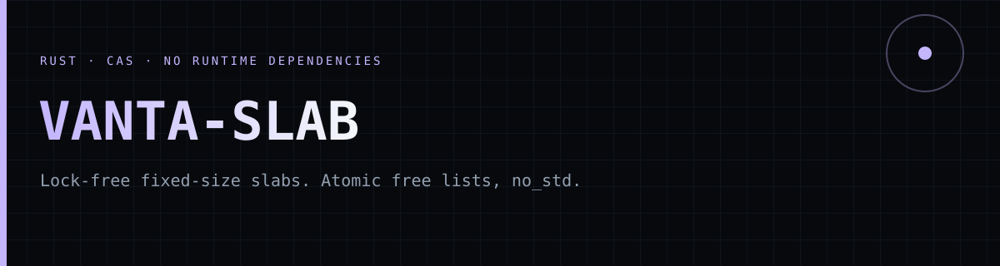

<p align="center">
  
</p>

# vanta-slab

Lock-free slab allocator written in pure Rust.

Implements fixed-size object pools using atomic free lists.
No external dependencies. Compatible with `no_std`.

## What it does

- Allocates and frees fixed-size blocks from pre-allocated slabs
- Uses compare-and-swap on free lists
- Size classes are 16, 32, 64, 128, 256, 512, 1024, and 2048 bytes
- Each slab's backing buffer is `1024 * 256` bytes. Classes of 16 through 256 bytes hold 1024 blocks. Larger classes hold fewer, because that buffer cannot fit 1024 objects of those sizes (512-byte class: 512 blocks, 1024-byte class: 256 blocks, 2048-byte class: 128 blocks)

## Usage

`VantaSlab` is about 2MB. Build it on the heap; a stack temporary can overflow.

```rust
use vanta_slab::VantaSlab;
use std::alloc::{alloc, Layout};

let mem = unsafe { alloc(Layout::new::<VantaSlab>()) as *mut VantaSlab };
let slab = unsafe {
    VantaSlab::write_new(mem);
    Box::from_raw(mem)
};
slab.init();

let layout = Layout::from_size_align(64, 8).unwrap();
if let Some(ptr) = slab.allocate(layout) {
    slab.deallocate(ptr, layout);
}
```

## Test

```bash
cargo test
```

`benches/slab_bench.rs` (`harness = false`) initializes a slab, runs an alloc/free loop, and prints the elapsed time. `cargo test` checks that the bench target exists; it does not run it.
